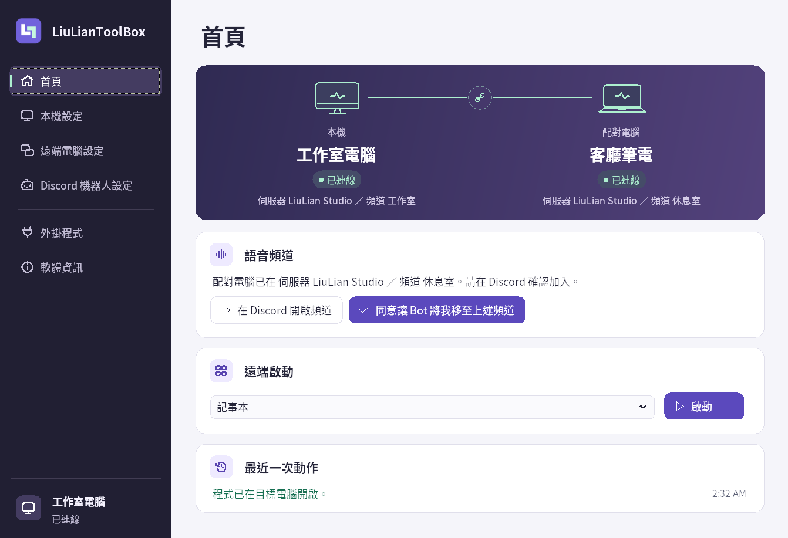

# LiuLianToolBox

LiuLianToolBox 是兩部 Windows 電腦使用的 Discord 桌面工具。兩端各執行一個用戶端，只透過官方 LiuLianBot 服務配對。首頁顯示兩部電腦的連線、語音頻道和最近一次動作。介面預設為繁體中文，可在本機設定切換至簡體中文或英文。



## Windows 安裝及背景執行

1. 從官方儲存庫成功的 **Windows installer** 建置下載 `LiuLianToolBox-Windows-x64`，解壓後在兩部電腦各自執行 `LiuLianToolBox-Setup-x64.exe`。安裝程式會將 ToolBox 加到目前使用者的開始功能表，毋須管理員權限。[官方 Windows 安裝程式建置](https://github.com/LiuLianMagicBox/LiuLianToolBox/actions/workflows/windows-installer.yml)
2. 如想每次登入 Windows 都自動執行，在安裝時勾選「登入 Windows 時在背景啟動 LiuLianToolBox」。預設為關閉。日後可重新執行安裝程式更改選項。
3. 按視窗的 **×** 後，ToolBox 會收起至時鐘旁的通知區。在電腦開啟及帳戶登入期間，同步、鬧鐘及已授權的遠端動作會繼續執行。按兩下通知區圖示，或再從開始功能表開啟 ToolBox，即可返回同一個視窗。
4. 要停止背景執行，在通知區圖示按右鍵選「結束 ToolBox」。更新或移除前亦請先結束程式。可從 Windows「設定」的「已安裝的應用程式」移除 ToolBox。重新安裝會沿用本機設定及裝置連結，如需撤銷授權，可先在程式內解除連結。

## 桌面介面

- 首次開啟時，從首頁按「連結此電腦」設定 LiuLianBot，再按「設定配對」。配對電腦上線並提供可用程式後，即可在首頁選擇程式並啟動。「最近一次動作」會顯示結果及時間。
- 在「本機設定」的「裝置與外觀」可選擇「跟隨 Windows」、「淺色」或「深色」，按右上角「儲存」即時套用。預設會跟隨 Windows，升級後亦會保留原有裝置設定。
- 視窗較窄時，側邊選單會收起成圖示。將滑鼠移至圖示可查看頁面名稱，亦可用 Tab 和 Enter 操作。

## 建置 Windows 安裝程式

在 Windows 安裝 .NET 10 SDK 及 64 位元 Inno Setup 7，然後在儲存庫根目錄執行以下 PowerShell 指令。安裝程式會包含 .NET 執行階段。[Inno Setup 官方下載](https://jrsoftware.org/inno-setup/downloads)

```powershell
dotnet build LiuLianToolBox.slnx -c Release
dotnet publish src/ToolBox.Desktop -c Release -r win-x64 --self-contained true -p:PublishSingleFile=true -p:EnableCompressionInSingleFile=true -p:IncludeNativeLibrariesForSelfExtract=true -p:DebugType=None -o artifacts/win-x64
& "$env:ProgramFiles\Inno Setup 7\ISCC.exe" installer\LiuLianToolBox.iss
```

輸出為 `artifacts/installer/LiuLianToolBox-Setup-x64.exe`。開發時可在 Windows 使用 `dotnet run --project src/ToolBox.Desktop`，或加上 `-- --background` 測試背景啟動。官方 LiuLianBot 已內建桌面 API。在 Discord 的 `/help` 選擇 `command: toolbox` 可查看六個子指令。[Bot 建置及主機設定](integrations/liulianbot/README.md)

## 配對與雙 PC 動作

1. 在每部電腦的「本機設定」填寫容易辨認的名稱並儲存。在 Discord 選擇官方 **LiuLian** 機器人的 `/toolbox link`，將連結碼貼到該機的「Discord 機器人設定」，按「連結此電腦」。每部電腦各用一個連結碼。程式會自動連到 `https://www.liulian.dev/toolbox`。
2. 在 A 的「遠端電腦設定」按「產生配對碼」，用「複製配對碼」把代碼交給 B。B 在相同頁面輸入後按「配對」。連結碼及配對碼均只可使用一次，五分鐘後失效。首頁會顯示另一部電腦。
3. 如要由 A 啟動 B 的程式，先在 B 的「本機設定」選取允許開啟的 `.exe` 並儲存。然後在 A 的首頁選擇程式並按「啟動」。B 會核對發送端、目標裝置及本機清單。A 可查看成功、程式不存在、電腦離線或結果待確認等狀態。
4. 如要 B 跟隨 A，在 B 啟用語音跟隨，兩個 Discord 帳戶需在 LiuLianBot 可見的伺服器內使用語音頻道。A 加入頻道後，B 可從首頁開啟目標頻道。若 B 身處同一伺服器的另一個語音頻道，亦可按下同意移動的按鈕，由 Bot 核對兩個頻道、雙方權限及人數上限後移動 B。其他情況可於 Discord 手動加入。已核對伺服器及頻道 ID 相同時，提示會消失。同一帳戶連結多部電腦時仍可使用鬧鐘及程式啟動，語音跟隨及分享提示則需要兩個帳戶。[Discord 官方成員移動介面](https://docs.discord.com/developers/resources/guild#modify-guild-member)
5. 如要在同頻道分享，在「遠端電腦設定」啟用分享提示並選擇負責分享的電腦，再在該機的「本機設定」選取螢幕或視窗。兩端上線且 Bot 確認兩個帳戶位於同一頻道後，所選電腦才會提示在 Discord 選取該來源並按 **Go Live**。曾選擇的視窗關閉後，用戶端會提示重新選取。[Discord 畫面分享操作](https://support.discord.com/hc/en-us/articles/360040816151-Go-Live-and-Screen-Share)

設定和待響鬧鐘儲存在 `%LOCALAPPDATA%\LiuLianToolBox\settings.json`。裝置憑證以目前 Windows 使用者的 DPAPI 加密。電腦向 Bot 發出連線，兩部 PC 均毋須開放入站連接埠。要更換配對電腦，可在遠端設定解除配對。要撤銷遺失電腦的授權，可在 Discord 執行 `/toolbox unlink pc:<裝置 ID>`。

由舊版升級時，已連到同一官方網址的電腦會保留授權。曾使用其他網址或缺少服務記錄的電腦，需要向官方 Bot 重新取碼。舊服務的憑證、待響鬧鐘及動作記錄會從本機清除，裝置名稱、語言、外觀、應用程式清單和語音分享偏好會保留。

## LiuLianBot 功能

| 功能 | 用法 |
| --- | --- |
| 鬧鐘 | 在「Discord 機器人設定」選擇自己的預設電腦。使用 `/toolbox alarm time:2030-06-01T09:00:00+08:00`，或加上 `pc:<名稱或裝置 ID>` 指定另一部自己的電腦。Bot 回覆目標及時間。各機會在本機儲存收到的鬧鐘，ToolBox 開啟期間即使其後斷線仍可響鬧。 |
| 私人語音頻道 | 按「載入我的頻道」，選擇頻道後修改名稱及人數上限。上限為 0 表示不限。儲存時 Bot 會核對當前擁有人、成員及 Bot 的 Discord 權限。 |
| 閒置自動回覆 | 獲授權者可設定閒置分鐘數、開關和回覆內容。聯絡人使用 `/toolbox contact user:<使用者>`。所有在線用戶端均已閒置時，Bot 才會回覆設定內容。任何一部恢復活動後會在下次同步更新狀態。 |
| 留言箱 | 獲授權者可在閒置回覆加入留言入口，選擇本人已驗證的電郵或 Discord 私訊。聯絡人使用 `/toolbox message` 留言，並可憑回條使用 `/toolbox receipt` 查詢狀態。兩種收件方式均先經 MailServer。 |
| 外掛程式 | 現階段顯示 TODO/WIP。 |

## 驗證

```sh
dotnet test LiuLianToolBox.slnx -c Release
python3 -m unittest discover -s integrations/mailserver -v
python3 integrations/liulianbot/build.py ../LiuLianBot --test --dotnet dotnet
```

最後一項會編譯真正的 Bot 擴充，啟動本機測試服務，以兩個 .NET 用戶端驗證配對、遠端啟動、鬧鐘派送及解除配對。MySQL 測試使用獨立測試資料庫，設定方法見擴充說明。[整合測試](integrations/liulianbot/README.md#整合測試)
